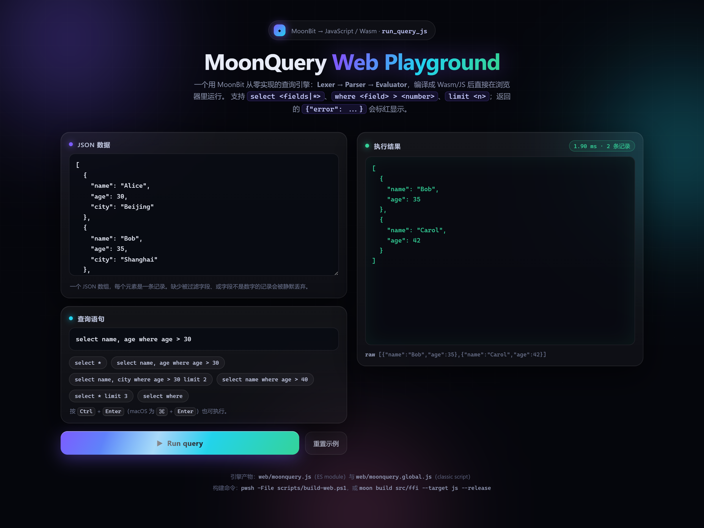

<div align="center">

# MoonQuery

**基于 MoonBit / Wasm 的前端轻量级 JSON 查询引擎**

给它一段 JSON 数组和一句类 SQL 查询，它返回过滤 + 投影后的 JSON。
`Lexer → Parser → Evaluator → FFI → Web` 全链路由 MoonBit 从零实现，编译后直接在浏览器里运行。




</div>

---

## ✨ 这是什么

MoonQuery 是一个跑在前端的轻量级 JSON 查询引擎：**输入 JSON 数组 + 查询语句，输出结果 JSON**，零后端、零运行时依赖、零 glue code。

```text
  输入   [{ "name": "Alice", "age": 30 }, { "name": "Bob", "age": 35 }]
  查询   select name where age > 30
  输出   [{"name":"Bob"}]
```

## 📖 查询语法

| 子句 | 说明 | 示例 |
| --- | --- | --- |
| `select <fields>` / `select *` | 投影字段，`*` 表示保留整条记录 | `select name, age` / `select *` |
| `where <field> > <number>` | 数值过滤；字段缺失或不是数字的记录会被静默丢弃 | `where age > 30` |
| `limit <n>` | 只保留前 N 条（越界自动截断） | `limit 2` |

子句顺序固定为 `select ... [where ...] [limit ...]`；非法查询、非法 JSON、顶层不是数组这几种情况统一返回 `{"error": "..."}`，不抛异常。

## 🏗 项目架构

```text
          JSON 文档 + 查询字符串
                   │
   ① src/lexer ────► Token 流                    手写词法分析器
                   │
   ② src/parser ───► Query / Expr                递归下降解析器
                   │
   ③ src/evaluator ► filter → limit → project    求值核心（纯函数）
                   │
   ④ src/ffi ──────► #export_name("run_query_js")  →  JS / Wasm
                   │
   ⑤ web/ ─────────► Web Playground（index.html 直接调用 run_query_js）
```

| 包 | 职责 | 关键 API |
| --- | --- | --- |
| `src/lexer` | 词法分析，产出 `Token` 流 | `tokenize(String) -> Array[Token]` |
| `src/parser` | 语法分析，产出 AST | `parse(Array[Token]) -> Result[Query, String]` |
| `src/evaluator` | 求值核心：过滤 → limit → 投影 | `execute(Query, Array[Json])`、`run_query(String, String) -> String` |
| `src/ffi` | `foreign_library`，把引擎导出给 JS / Wasm | `#export_name("run_query_js")` |
| `src/main` | CLI 可执行程序 | `moon run src/main -- <query> [json]` |

JSON 的解析与序列化使用官方 `moonbitlang/core/json`：`Json` 的 `Object` / `Array` / `Number` / `String` 等构造子是只读的，构造时需走 `Json::object`、`Json::array` 这类工厂函数。

## 🚀 构建与运行

环境：MoonBit `0.1.20261023`（新版 `moon.pkg` 配置）。

### 1. 测试

```bash
moon test                 # 全模块：lexer / parser / evaluator
moon test -p evaluator    # 只跑求值器
```

### 2. 命令行（CLI）

```bash
moon run src/main -- "select name, age where age > 30 limit 2"
moon run src/main -- "select name, city" "[{\"name\":\"Bob\",\"age\":35}]"
moon run src/main -- --query "select *" --json "[{\"a\":1,\"b\":2}]"
moon run src/main -- --help
```

不传 JSON 时使用内置示例数据集。Windows PowerShell 5.1 下，内联 JSON 里的双引号要写成 `\"`（外层用单引号包住整个参数）：

```powershell
moon run src/main -- "select name where age > 30" '[{\"name\":\"Bob\",\"age\":35}]'
```

### 3. Web Playground

```bash
# 构建 js 产物并暂存到 web/
powershell -File scripts/build-web.ps1        # PowerShell 7 可用 pwsh -File ...

# 起一个静态服务器
cd web
python -m http.server 8080                    # 或 npx --yes serve web

# 浏览器打开 http://localhost:8080/
```

`web/index.html` 也可以直接双击打开：它优先加载 classic script 版本（`moonquery.global.js`），仅在缺失时才回退到 ES module。

## 📦 构建产物

| 产物 | 路径 | 说明 |
| --- | --- | --- |
| **JS（网页使用）** | `_build/js/release/build/ffi/ffi.js` | 自包含 ES module；`run_query_js` 的 `String` 直接映射为 JS string，无需 glue |
| 类型声明 | `_build/js/release/build/ffi/ffi.d.ts` | `run_query_js(json: string, query: string): string` |
| Wasm（wasm-gc） | `_build/wasm-gc/release/build/ffi/ffi.wasm` | 同样导出 `run_query_js`，但为 wasm-gc 引用 ABI，需 glue 才能给 JS 传字符串 |
| Wasm（wasm） | `_build/wasm/debug/build/ffi/ffi.wasm`、`.../main/main.wasm` | `moon build` 默认 target，同时产出 CLI 可执行文件 |
| 网页暂存 | `web/moonquery.js` | 上面 ES module 的拷贝：`import { run_query_js } from "./moonquery.js"` |
| 网页暂存 | `web/moonquery.global.js` | classic script 版本：`globalThis.run_query_js`，可用普通 `<script src>` 加载 |

## ✅ 测试结果

```text
$ moon test
Total tests: 12, passed: 12, failed: 0.

lexer       1   tokenize "select name, age where age > 18"
parser      1   parse "select name, age where age > 18 limit 10"
evaluator  10   filter / limit / 字段投影 / select * / 缺失字段 / 非法查询 / 非法 JSON / 非数组文档
```

除单元测试外，还用无头 Chromium 真实渲染了 Playground 页面（`file://` 与 HTTP 两种加载方式），确认没有任何 console / page error，并分别校验了「正常结果」与「错误标红」两种状态。

## 🗂 目录结构

```text
MoonQuery/
├── moon.mod                 # 模块元数据（source = "src"）
├── src/
│   ├── lexer/               # ① 词法分析
│   ├── parser/              # ② 语法分析
│   ├── evaluator/           # ③ 求值核心
│   ├── ffi/                 # ④ JS / Wasm 导出（foreign_library）
│   └── main/                # ⑤ CLI 可执行
├── web/
│   ├── index.html           # Web Playground（内联 CSS / JS）
│   ├── moonquery.js         # 构建产物（ES module）
│   ├── moonquery.global.js  # 构建产物（classic script）
│   └── preview.png          # 页面截图
├── scripts/
│   ├── build-web.ps1        # 构建 + 暂存 + 冒烟测试
│   └── smoke-web.cjs        # Node 端产物校验
└── README.md
```

## 💡 实现要点

- **手写词法器 + 递归下降解析器**：不依赖任何 parser generator，数字、标识符、关键字都是逐字符推进。
- **求值是纯函数**：`execute` 依次做 filter → limit → project，不修改输入数据；字段缺失或类型不符的记录直接丢弃，不会 panic。
- **官方导出方式**：`#export_name` 必须搭配 `pkgtype(kind: "foreign_library")`，且该属性不会跨包生效，因此单独用 `src/ffi` 包做了一层 wrapper。
- **一份代码三种产物**：同一个 `src/ffi` 包可分别产出 `js`（ESM）、`wasm-gc`、`wasm`，网页端只需纯 JS。
- **`run_query` 永不抛异常**：所有失败路径统一成 `{"error": "..."}` 文档，前端只需判断返回体。

## 备注

- `web/moonquery.js` 与 `web/moonquery.global.js` 是构建产物，为了方便静态托管（如 GitHub Pages）直接运行而保留在版本库中，可用 `scripts/build-web.ps1` 重新生成。
- 含中文的文件（`README.md`、`web/index.html`、`.gitignore`）均为 **UTF-8 无 BOM**；在 Windows PowerShell 5.1 下修改请显式指定 `-Encoding UTF8`，否则会被写成 GBK。

## 📄 License

Apache-2.0